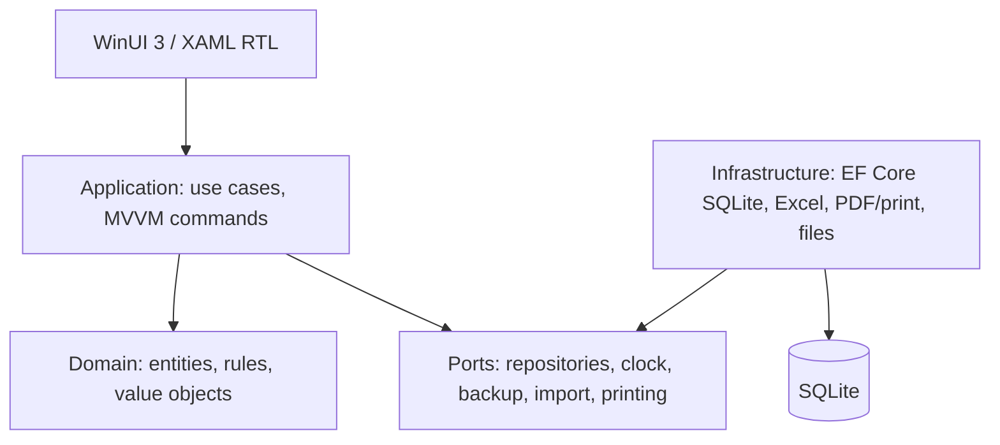

# المعمارية المقترحة

## القرار

**Modular Monolith** داخل **Clean Architecture** مناسب للحجم الحالي: تطبيق واحد وقاعدة SQLite واحدة، وحدود وحدات واضحة تسمح بفصلها لاحقًا دون تكلفة microservices.

## الطبقات

- **Presentation:** Windows App SDK وXAML وViewModels وNavigation وRTL. لا تحتوي SQL أو قواعد مالية.
- **Application:** حالات الاستخدام (ترحيل بيع، استلام، تحصيل، مرتجع، جرد، استيراد)، معاملات، DTOs، validation، وخدمات التقارير.
- **Domain:** الكيانات وقواعد المجال المستقلة عن WinUI وEF، مثل حساب الرصيد وقابلية الإرجاع واقتراح FEFO.
- **Infrastructure:** EF Core mappings وSQLite migrations لاحقًا، repositories، Excel، الطباعة، النسخ الاحتياطي، الساعة والملفات.
- **Composition/Host:** تركيب الخدمات، إعداد المسارات، logging، وترقية قاعدة البيانات.

## الوحدات

Catalog & Inventory، Purchasing، Sales & Orders، Parties & Ledger، Delivery & Collection، Returns، Stocktake، Reporting، Import/Export، Audit وBackup. تتشارك الوحدات domain primitives وقراءة تقارير محدودة عبر application contracts.

## مبادئ المعاملات

ترحيل المستند مع حركات المخزون والقيد الحسابي داخل transaction واحدة. المستند المرحل لا يحذف؛ التصحيح بعكس/مرتجع أو تعديل مضبوط حسب القرار. كل عملية تعتمد `IClock` ومرجعًا idempotency عند الاستيراد.

## قرارات تنفيذية موصى بها

- GUID داخلي للمفاتيح، وSQLite WAL بعد اختبار النسخ الاحتياطي.
- `decimal` للأموال، وUTC للتخزين مع عرض محلي.
- EF Core خلف repositories/use cases، مع استعلامات تقارير صريحة عند الحاجة.
- اختبارات Domain وApplication على Linux؛ بناء WinUI واختبارات UI على Windows لاحقًا.

## حدود البيئة

Zorin/Linux مناسب للمنطق والاختبارات والأدوات؛ WinUI 3 وWindows App SDK يحتاجان Windows لبناء وتشغيل الواجهة. لا يفترض التصميم توفر الإنترنت.

## SQLite في Infrastructure (Task 004)

`GenoCareDbContext` و`InventoryPersistence` يعزلان EF Core عن Domain وWinUI. مصدر حقيقة المخزون هو جدول `StockMovements`؛ لا يوجد رصيد قابل للتعديل في `Batch`. كل Post يبدأ SQLite transaction، و`TransactionId` مع `EntryIndex` يمنع إعادة نشر الحركة/الانتقال. فحص الرصيد والحفظ داخل المعاملة نفسها، مع رفض Issue غير المتاح، دون تطبيق سياسة التجاوز الإداري.

التخفيض في `StockAdjustment` يخضع لفحص الحالة نفسها (Available/Quarantined/Damaged) داخل المعاملة؛ الزيادة المشروعة لا تُمنع. العلاقة المركبة `(ProductId, BatchId)` في الحركة تشير إلى المفتاح المركب للصنف والتشغيلة، لذلك لا يكفي وجود الكيانين منفصلين. `StockMovements` append-only: يمنع DbContext تحديث أو حذف سجل مرحّل.

تُخزّن الأموال كنص invariant culture عبر ValueConverter للحفاظ على قيمة `decimal` كاملة بدل SQLite REAL التقريبية. تُشغّل migrations عند تهيئة قاعدة التطبيق في مسار Application Data الذي يحدده المضيف، وليس بجانب binaries. SQLite محلي وoffline؛ التزامن الكتابي المتزامن يحتاج معاملات قصيرة وسياسة إعادة محاولة مستقبلية، ولا توجد مزامنة أجهزة في هذه المرحلة.
