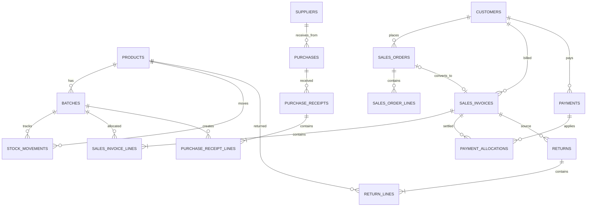

# تصميم قاعدة البيانات (تصور أولي)

هذا تصور قبل التنفيذ؛ لا توجد قاعدة أو migrations في هذه المهمة. أسماء الجداول/الأعمدة قابلة للمراجعة.

## الجداول المقترحة

- `products(id, internal_code, name, unit, current_retail_price, current_purchase_price, is_active)`
- `batches(id, product_id, batch_number, expiry_date)`
- `stock_movements(id, product_id, batch_id, quantity, movement_type, document_id, occurred_at)`
- `customers(id, name, phone, opening_balance, credit_limit, payment_term_days)` و`suppliers(...)`
- `sales_orders` و`sales_order_lines`
- `sales_invoices(id, customer_id, order_id, status, invoice_date, total, discount_total)` و`sales_invoice_lines(invoice_id, product_id, batch_id, quantity, bonus_quantity, unit_price, discount, line_total)`
- `purchases` و`purchase_receipts` و`purchase_receipt_lines`
- `payments(id, party_type, party_id, amount, payment_date, method, reference)` و`payment_allocations`
- `returns` و`return_lines`
- `stocktakes` و`stocktake_lines` و`adjustments`
- `representatives` و`deliveries`
- `audit_entries(id, actor, action, entity_type, entity_id, before_json, after_json, occurred_at)`

## قواعد تصميم

المبالغ `decimal` في المجال (تمثيل مناسب في SQLite)، والكميات decimal/whole حسب القرار. كل FK وحالة وتاريخ لها فهارس مناسبة؛ `internal_code` فريد؛ لا حذف متسلسل للمستندات المرحّلة. حفظ snapshot السعر والخصم في سطر الفاتورة إلزامي. يضاف `created_at/updated_at` حيث يلزم، و`row_version` عند دعم تعدد الأجهزة.

## ERD مبدئي

## أسئلة تقنية لاحقة

اختيار GUID/INTEGER، ترقيم المستندات، تمثيل JSON، التشفير، WAL، وفهرسة تقارير الرصيد؛ تحسم قبل أول migration.
