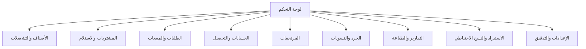

# خريطة الشاشات والتنقل

الواجهة عربية RTL، مع شريط تنقل رئيسي ولوحة ملخص. كل شاشة تعرض حالة التحميل/الخطأ، وتمنع فقد المدخلات غير المحفوظة.

## الشاشات

- **لوحة التحكم:** مبيعات اليوم، مستحقات، تنبيهات الصلاحية والنقص، وروابط سريعة.
- **الأصناف:** قائمة/بحث/تحرير Product، شاشة Batches، حركة المخزون.
- **المشتريات:** الموردون، شراء Draft، الاستلام الجزئي، كشف المورد.
- **المبيعات:** العملاء، الطلب، محرر الفاتورة، اختيار Batch/FEFO، الطباعة والتسليم.
- **الحسابات:** كشف عميل/مورد، Payment، الأرصدة الافتتاحية، الائتمان.
- **المرتجعات:** مرتبط/استثنائي، التحقق، الاعتماد، الطباعة.
- **الجرد:** جلسة جرد، إدخال العد، الفروق، اعتماد التسوية.
- **التقارير:** مبيعات، مخزون، صلاحية، نقص، أرباح تقريبية، كشوف حساب.
- **الاستيراد والنسخ:** اختيار ملف، معاينة، أخطاء، تنفيذ/استعادة/اختبار نسخة.
- **التدقيق والإعدادات:** سجل التعديلات، بيانات المنشأة، العملة والتنسيق، النسخ.

## قواعد تجربة المستخدم

اختصارات لوحة مفاتيح للفوترة والبحث، إبراز الحالات والأخطاء بالعربية، تأكيد قبل Post/Reverse، وعدم إخفاء Batch أو الخصم أو سبب التعديل.
